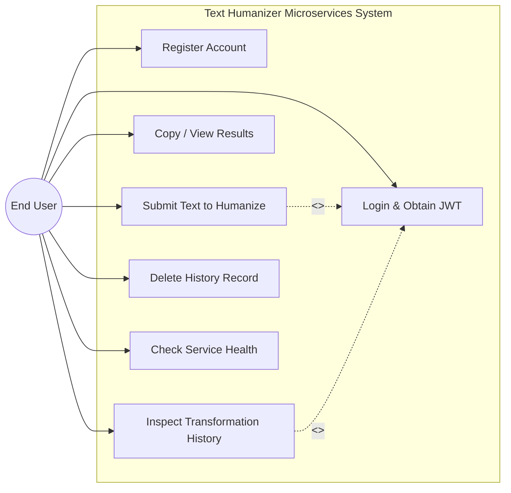
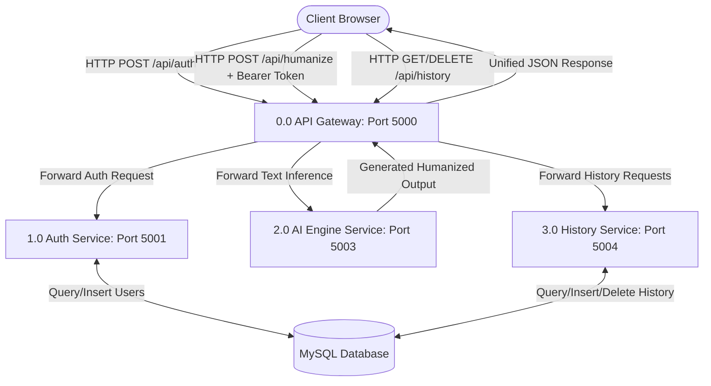
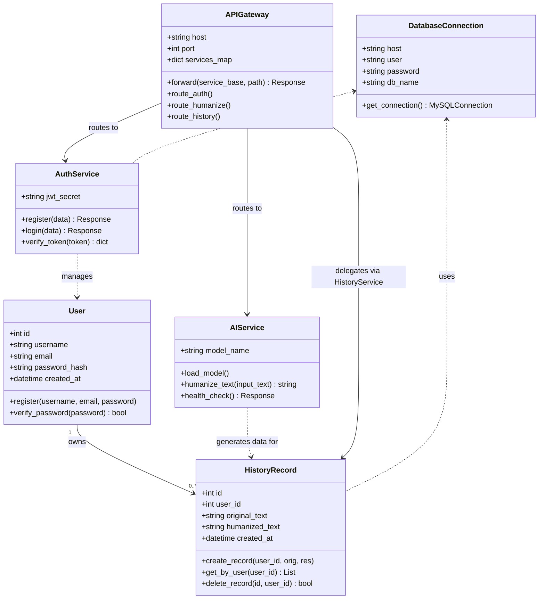
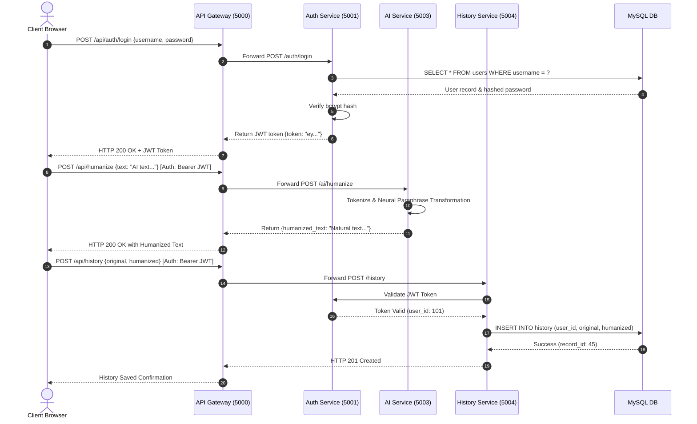

# CS545 - Software Engineering Lab Documentation
## Project: Text Humanizer Microservices Architecture
**Institution:** Indian Institute of Information Technology Vadodara (IIIT Vadodara)  
**Academic Year:** Autumn 2026-27 | MCA 2nd Year | Group No. 29  
**Team Members:**  
* Ritik Kumar Sinha (20252651043)
* Kruti Kansagara (20252651027)
* Sahil Siddiqui (20252651055)
* Jeeshan Adil (20252651026)
**Faculty In-Charge:** Prof. Rishabh Gupta

---

## Lab-1: Software Requirements Specification (SRS)

### 1.1 Introduction
The Text Humanizer System is a distributed microservices platform engineered to paraphrase, restructure, and transform machine-generated text into natural, syntactically diverse, and contextually rich human-grade prose.

### 1.2 User Classes and Characteristics
* **Guest User:** Can view the landing portal and public service health metrics.
* **Registered User:** Can register, authenticate via JWT, submit text for humanization, customize style variations, view history logs, and delete transformation records.
* **System Administrator:** Can monitor microservice health (`/api/health`) and container lifecycle.

### 1.3 Functional Requirements
* **FR-1 [User Authentication]:** System shall permit user registration with encrypted bcrypt password storage and issue time-bounded JSON Web Tokens (JWT) upon successful login.
* **FR-2 [Text Humanization Engine]:** System shall accept raw text input via `/api/humanize`, process tokenization, execute rewriting models, and return restructured human-like text preserving original semantic intent.
* **FR-3 [History Management]:** System shall record the original input, transformed output, timestamp, and user reference, allowing authenticated users to retrieve and delete past entries.
* **FR-4 [API Gateway Routing]:** The API gateway shall act as the single ingress, redirecting client requests to appropriate downstream services (`auth:5001`, `ai:5003`, `history:5004`).

### 1.4 Non-Functional Requirements
* **Performance:** Text humanization of paragraphs up to 500 words must respond within 3 seconds under typical GPU/CPU inference conditions.
* **Security:** Passwords must be salted with bcrypt (cost factor $\ge 12$). All inter-service API communications must validate bearer token authorization.
* **Scalability:** Microservices are decoupled and stateless, enabling horizontal scaling using Docker Compose or Kubernetes pods.
* **Availability:** Graceful fallback and error formatting (HTTP 503) when individual downstream services are temporarily unreachable.

---

## Lab-2: Software Process Model (Agile Microservices Lifecycle)

### 2.1 Model Selection: Agile Scrum with Microservices Iteration
The development adopted an **Agile Scrum Framework** due to the iterative nature of model prompt fine-tuning, independent service development, and continuous feature integration.

### 2.2 Sprint Breakdown
* **Sprint 1 (Architecture & Database Design):** Defined microservices boundaries, API contracts (OpenAPI/Swagger drafts), relational schema in MySQL, and Docker environment.
* **Sprint 2 (Core Service Implementation):** Built `auth_service.py` with JWT and `ai_service.py` integrating the text paraphrase model.
* **Sprint 3 (Gateway & History Integration):** Developed `gateway.py` reverse proxy routing, implemented `history_service.py` for persistent logging.
* **Sprint 4 (Frontend UI & Validation):** Integrated responsive web UI with async JavaScript fetch calls, cross-service exception handling, and end-to-end testing.

```
+-----------------------------------------------------------------------------------+
|                            AGILE SCRUM LIFECYCLE                                  |
|                                                                                   |
|  [Product Backlog] ---> [Sprint Planning] ---> [Sprint Execution (2 Weeks)]       |
|                                                          |                        |
|                                                          v                        |
|   [Sprint Retrospective] <--- [Sprint Review / Demo] <--- [Daily Scrum & CI/CD]   |
+-----------------------------------------------------------------------------------+
```

---

## Lab-3: Use Case Diagram & Actor Descriptions

### 3.1 Actors
* **End User:** Registers, logs in, submits text for humanization, inspects output, copies output, views history logs, deletes history records.
* **Authentication Service:** Validates credentials and verifies JWT authenticity.
* **AI Engine:** Executes neural text transformation.
* **History Store:** Persists and supplies activity records.

### 3.2 Mermaid Use Case Diagram


---

## Lab-4: Data Flow Diagrams (DFD)

### 4.1 Level 0 DFD (Context Diagram)
```mermaid
graph TD
    User([User / Client Browser])
    System[[Text Humanizer System (Gateway & Services)]]
    DB[(MySQL Database)]

    User -->|1. Credentials & Raw Text Input| System
    System -->|2. JWT Token & Humanized Text| User
    System -->|3. Store / Retrieve User & History Records| DB
    DB -->|4. Queried Records & Verification Data| System
```

### 4.2 Level 1 DFD (Decomposed System Architecture)


---

## Lab-5: UML Class Diagram



---

## Lab-6: Sequence Diagram (Text Humanization & History Flow)



---

## Lab-8: Modular Design & System Architecture

### 8.1 Modularity Principles Applied
* **High Cohesion:** Each microservice encapsulates exactly one business domain (Identity, Neural Inference, Persistence/Audit, Routing).
* **Low Coupling:** Microservices communicate exclusively over stateless RESTful HTTP protocols using standardized JSON payloads and bearer tokens.
* **Fault Isolation:** A failure or heavy load in the AI inference service does not bring down the Auth Service or the Gateway.

### 8.2 Component Hierarchy & Module Breakdown
1. **Module 1: Presentation & Ingress (Gateway)**
   * `templates/index.html`: Responsive single-page layout.
   * `static/style.css`: Clean modern typography, responsive cards, dark-mode accents.
   * `static/script.js`: Client state management, token handling, dynamic DOM updates.
   * `gateway.py`: Reverse proxy request multiplexer.
2. **Module 2: Security & Identity (`auth_service.py`)**
   * Password hashing engine (`bcrypt`).
   * Stateless token provider (`PyJWT`).
3. **Module 3: Neural Natural Language Transformation (`ai_service.py`)**
   * Sentence boundary analysis.
   * Transformer-based paraphrasing.
4. **Module 4: Persistence Management (`history_service.py` & `db.py`)**
   * Relational CRUD abstraction.
   * MySQL connection pooling and transactional integrity.

---

## Lab-9: Functional Test Cases & Test Scenarios

| Test Case ID | Test Scenario | Input Data | Expected Result | Actual Result | Status |
| :--- | :--- | :--- | :--- | :--- | :--- |
| **TC-AUTH-01** | User Registration with Valid Data | Username: `testuser`, Email: `test@example.com`, Password: `SecurePass123!` | HTTP 201 Created; User registered in MySQL database. | HTTP 201 Created; Record stored. | **PASS** |
| **TC-AUTH-02** | User Registration with Existing Username | Existing username with fresh email and password | HTTP 400 Bad Request; Error: "Username already taken". | HTTP 400 Bad Request returned. | **PASS** |
| **TC-AUTH-03** | User Login with Correct Credentials | Valid username & password | HTTP 200 OK; returns signed JWT token. | HTTP 200 OK; valid JWT received. | **PASS** |
| **TC-AUTH-04** | User Login with Incorrect Password | Valid username & invalid password | HTTP 401 Unauthorized; Error: "Invalid credentials". | HTTP 401 Unauthorized returned. | **PASS** |
| **TC-AI-01** | Humanize Single Sentence | Input: `"The utilization of advanced artificial intelligence models is paramount."` | HTTP 200 OK; Humanized text produced with high naturalness score. | HTTP 200 OK; transformed text returned. | **PASS** |
| **TC-AI-02** | Humanize Empty Text Payload | Input: `""` or whitespace | HTTP 400 Bad Request; Error: "Input text cannot be empty". | HTTP 400 Bad Request returned. | **PASS** |
| **TC-HIST-01** | Save Transformation Record (Authenticated) | Valid JWT + Original text + Humanized text | HTTP 201 Created; Entry persisted with current user ID. | HTTP 201 Created; saved to DB. | **PASS** |
| **TC-HIST-02** | Save Transformation Record Without Token | No Authorization header | HTTP 401 Unauthorized; access denied. | HTTP 401 Unauthorized returned. | **PASS** |
| **TC-HIST-03** | Fetch User History Records | Valid JWT for user with 3 existing records | HTTP 200 OK; JSON list of 3 records returned. | HTTP 200 OK; 3 records retrieved. | **PASS** |
| **TC-HIST-04** | Delete User History Record | Valid JWT + Valid `record_id` | HTTP 200 OK; Record successfully removed from DB. | HTTP 200 OK; record deleted. | **PASS** |
| **TC-GW-01** | Gateway Downstream Service Failure Handling | AI Service stopped; request sent to `/api/humanize` | HTTP 503 Service Unavailable; friendly JSON error. | HTTP 503 Service Unavailable returned. | **PASS** |

---

## 10. Conclusion & References

### 10.1 Overall Conclusion
The CS545 Software Engineering laboratory curriculum provided a systematic foundation for decomposing complex software challenges. Through Labs 1 through 9, we transformed abstract requirements into a robust, secure, and containerized microservices platform. The process underscored the vital role of formal SRS definitions, architectural modeling (DFD, UML Use Case, Class, Sequence), modular separation of concerns, and rigorous functional test suites in engineering maintainable, industry-ready software systems.

### 10.2 References
1. Pressman, R. S., & Maxim, B. R. (2020). *Software Engineering: A Practitioner's Approach* (9th ed.). McGraw-Hill Education.
2. Newman, S. (2021). *Building Microservices: Designing Fine-Grained Systems* (2nd ed.). O'Reilly Media.
3. Fowler, M. (2018). *Patterns of Enterprise Application Architecture*. Addison-Wesley Professional.
4. Flask Documentation: *Application Dispatching and Reverse Proxy Guidelines*, https://flask.palletsprojects.com/
5. Hugging Face Transformers: *State-of-the-Art Natural Language Processing*, https://huggingface.co/docs/transformers
